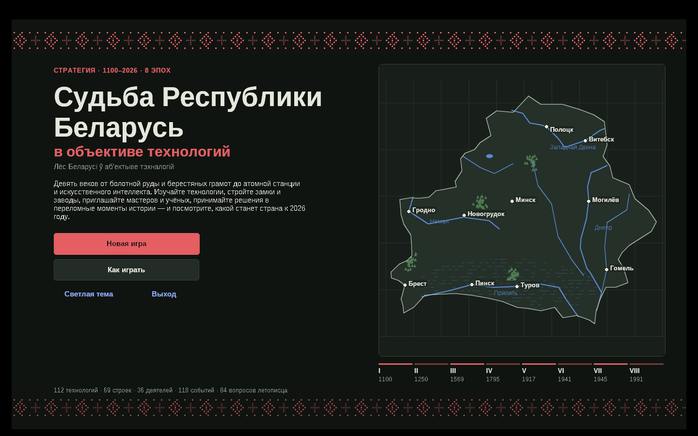
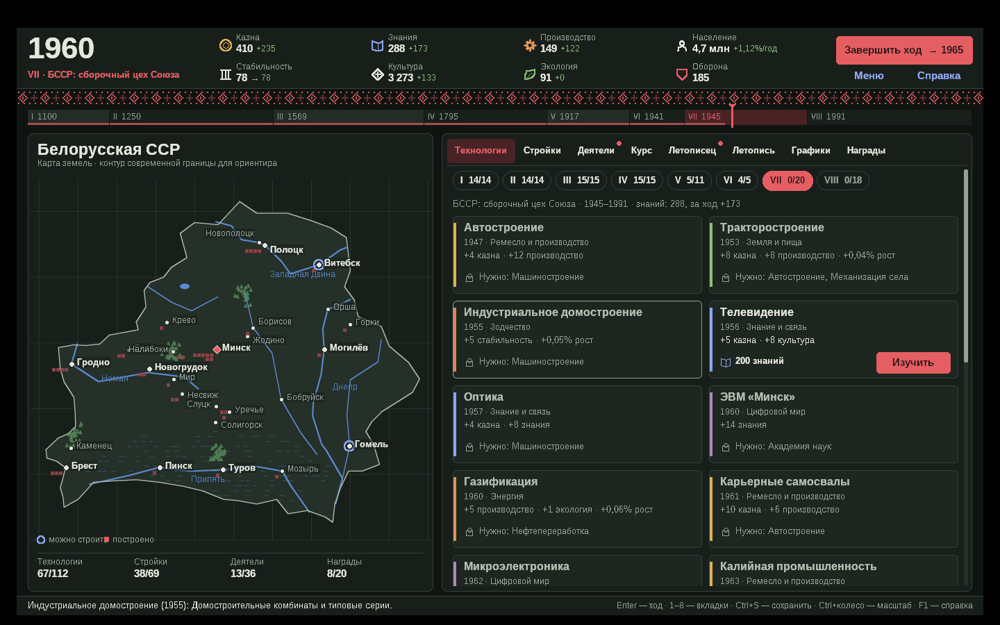
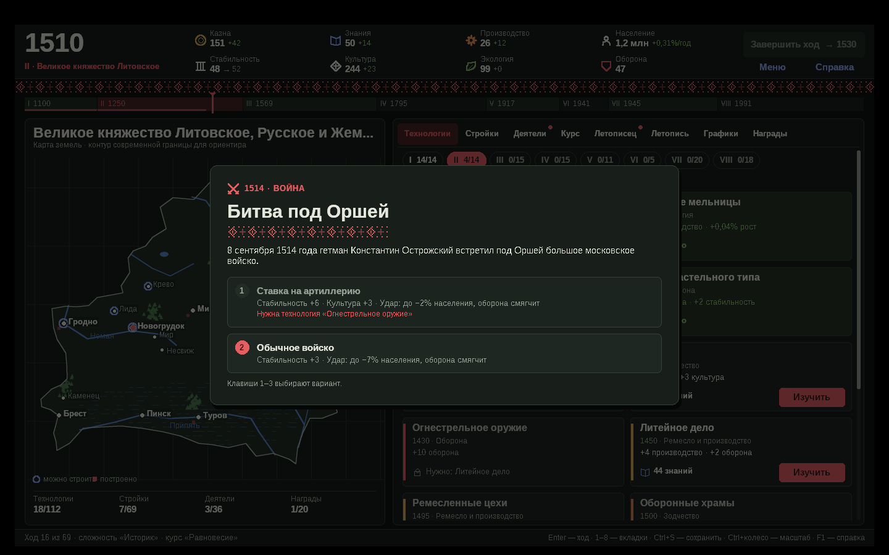
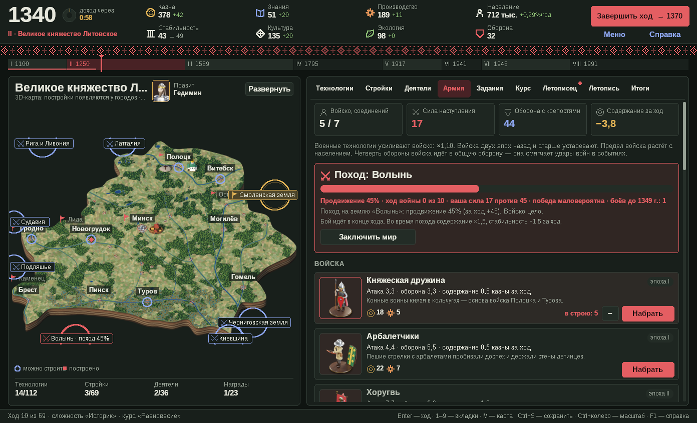
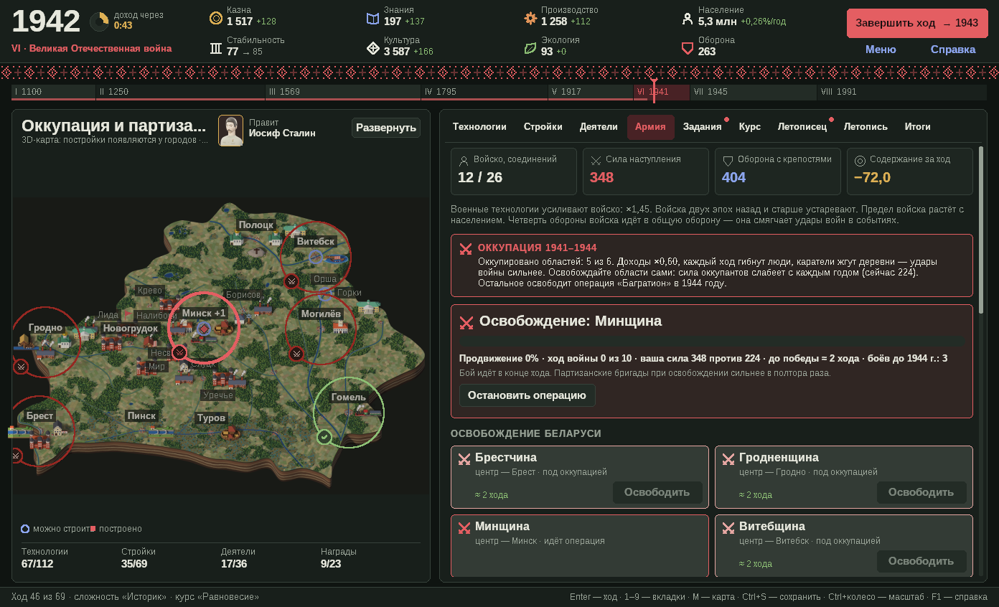
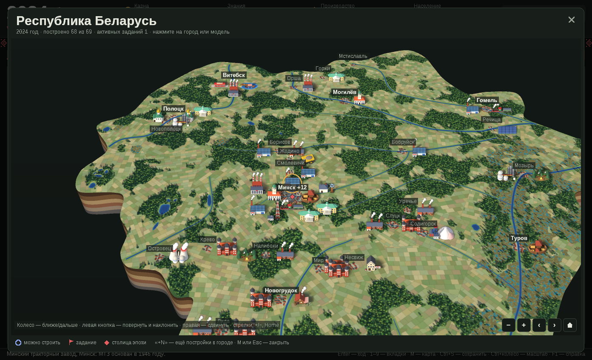

# Судьба Республики Беларусь в объективе технологий

*Лёс Беларусі ў аб’ектыве тэхналогій*

Пошаговая стратегия о том, как технологии меняли белорусские земли с 1100 по 2026 год:
от болотной руды и берестяных грамот до ЭВМ «Минск», БелАЗа, атомной станции и искусственного интеллекта.

**Запуск:** скачайте `BelarusTech.exe` и откройте его. Установка не нужна.
Это нативное приложение Windows (Win32 + GDI) на C без сторонних библиотек и без WebView:
исполняемый файл использует только системные `kernel32`, `user32`, `gdi32` и `msvcrt`.
Работает на Windows 7, 8, 10 и 11 (64-бит).








*Скриншоты сняты под Wine, поэтому шрифты заменены; в Windows используются Segoe UI, Palatino, Cambria, Bahnschrift и Consolas — у каждой эпохи свой.*

## Что внутри

| | |
|---|---|
| Эпохи | 8: Полоцкая и Туровская земли → ВКЛ → Речь Посполитая → Российская империя → становление БССР → Великая Отечественная → «сборочный цех Союза» → Республика Беларусь |
| Ходы | 69, от 25 лет в Средневековье до 3 лет в XXI веке |
| Технологии | 112 в девяти отраслях, с деревом зависимостей и историческими справками |
| Стройки | 69 реальных объектов на карте: Спасская церковь, Каменецкая вежа, Мирский и Несвижский замки, МАЗ, МТЗ, БелАЗ, «Интеграл», метро, ПВТ, БелАЭС… |
| Деятели | 36: Евфросиния Полоцкая, Скорина, Семенович, Тизенгауз, Наркевич-Иодко, Сухой, Лопато, Алфёров, Климук, Василевская… |
| События | 89 исторических развилок с выбором и 29 случайных |
| Летописец | 84 вопроса по истории техники (один за ход, награда — знания) |
| Армия | 16 видов войск — от княжеской дружины и крылатых гусар до танковых дивизий и ПВО; походы за 11 соседних земель, набеги, осады, оккупация и освобождение 1941–1944 |
| Города | 30 городов, у каждого своя специализация (столица, крепость, торговля, наука, культура, промышленность, недра, энергетика, земледелие, речной порт, пуща, ремёсла) и описание |
| Задания | 43 исторических задания со сроками и наградами, флажки на карте |
| Правители | 36 князей, королей, императоров, руководителей СССР и БССР, глав Республики Беларусь |
| 3D | Настоящая 3D-карта Беларуси: её можно вращать, наклонять, приближать и отдалять мышью. Карта, модели построек, 71 портрет деятелей и правителей и фигурки войск сделаны в Blender и встроены в `.exe` |
| Прочее | 23 награды, 7 курсов правления, 3 уровня сложности, графики с реальной демографией, летопись, светлая и тёмная тема, масштаб интерфейса, автосохранение |

Оборона смягчает войны, медицина — эпидемии, экология тормозит или ускоряет рост населения.
Некоторые варианты в событиях открываются только с нужной технологией: так знания спасают людей.
Баланс откалиброван симуляцией: на уровне «Историк» к 2026 году в среднем получается около 10 млн жителей
(в реальности — около 9,1 млн).

## Армия и война

Вкладка **«Армия»** — стратегия в духе HOI4, только на 900 лет:

* **Войско.** 16 видов войск открываются с эпохами и технологиями: дружина, арбалетчики, хоругвь, пушкари, мушкетёры,
  крылатые гусары, ракетная батарея Семеновича, линейная пехота, полевая артиллерия, стрелковые дивизии, авиаполки,
  партизанские бригады, мотострелки, танки, ракетные бригады, ПВО. Военные технологии усиливают все войска,
  войска прошлых эпох устаревают, предел численности растёт с населением, содержание идёт из казны каждый ход.
* **Оборона.** В эпохи I–III на границу каждый ход могут напасть — половцы, крестоносцы, Орда, шведы.
  Бой решают войско и крепости: победа даёт трофеи, поражение — потери казны и людей. Четверть обороны войска
  смягчает удары войн в исторических событиях.
* **Походы.** Соседние земли можно присоединить в те годы, когда они действительно переходили из рук в руки:
  Смоленщина, Подляшье, Латгалия, Волынь, Черниговщина, Киевщина, Рига, Судавия, Брянщина. Это страницы истории
  XII–XVIII веков: сегодня эти земли входят в соседние государства.
  Земля сразу даёт жителей, а каждый ход — доход, который растёт с эпохой. Прежний владелец может вернуться с осадой.
  После разделов Речи Посполитой (1795) земли становятся наследием: 30% дохода.
* **1941–1944.** Все шесть областей оккупированы: доходы падают, люди гибнут. Освобождайте области своими силами
  до операции «Багратион» — партизанские бригады при освобождении сильнее в полтора раза.

## Города

Каждый город особенный: Минск — столица, Полоцк — наука и книжность, Брест и Мир — крепости, Гродно и Могилёв — торговля,
Гомель и Жодино — промышленность, Солигорск и Новополоцк — недра, Островец — энергетика, Слуцк и Лида — ремёсла,
Пинск — речной порт, Налибоки — пуща… Каждая стройка поднимает уровень города, а уровень даёт бонус его специализации.
Нажмите на город на карте, чтобы прочитать о нём.

## 3D-карта

Карта рисуется собственным программным 3D-рендером (без OpenGL и библиотек): рельеф и текстура выгружены из сцены Blender
(`tools/blender/build_terrain3d.py`), в игре они выводятся с перспективой, z-буфером, mip-уровнями и сглаживанием.

* **Колесо мыши** — приблизить или отдалить (к точке под курсором).
* **Левая кнопка** — повернуть и наклонить карту; если мышь не двигалась, это обычный щелчок по городу или постройке.
* **Правая кнопка** — сдвинуть карту.
* Кнопки в углу карты: −, +, повернуть влево/вправо, «домик» — показать всю страну. На большой карте (`M`) — ещё стрелки, `+`/`−` и `Home`.

## Минутный доход

Пока идёт партия, каждую реальную минуту начисляются **казна, знания и производство**.
Кружок-часы справа от года в шапке показывает, сколько осталось до выплаты.
Сумма растёт с эпохой: в эпоху I это +7 казны, +4 знания и +3 производства,
в эпоху VIII — +47, +24 и +18 (на уровне «Историк»; «Летописец» даёт на 20% больше, «Суровый век» — на 10% меньше).
Часы стоят в свёрнутом окне, в главном меню и после 2026 года; время сна компьютера не засчитывается.

## Издатели

**Гимназия № 10 г. Минска**
**Биончик Роман**, учащийся 6 «Г» класса

Издатели указаны на титульном экране, в окне «Об игре», в итогах партии и в свойствах файла `BelarusTech.exe`.

## Управление

Мышь, а также клавиши: `Enter` — завершить ход или продолжить, `1–3` — выбор в событии,
`1–9` — вкладки, `M` — карта во весь экран, `Tab` — следующая вкладка, `Esc` — меню, `F1` — справка, `F2` — тема,
`Ctrl+S` — сохранить, `Ctrl+колесо` или `Ctrl+плюс/минус` — масштаб.

Сохранения лежат в `%APPDATA%\BelarusTechFate`.

## Сборка

Нужен MinGW-w64 (на Linux: пакет `gcc-mingw-w64-x86-64`; на Windows: MSYS2).

```sh
./build.sh
```

Проверка данных и баланса без графики (Linux, обычный gcc):

```sh
gcc -std=c11 -O2 -Isrc tests/sim.c src/engine.c src/war.c src/data_*.c -lm -o sim && ./sim
gcc -std=c11 -O2 -Isrc tests/terrain_test.c src/terrain3d.c src/image.c -lm -o terrain_test && ./terrain_test /tmp
```

## Устройство кода

| Файл | Назначение |
|---|---|
| `src/game.h`, `src/engine.c` | Движок: экономика, исследования, стройки, события, счёт, сохранения. Не зависит от Windows. |
| `src/war.h`, `src/war.c` | Армия: набор войск, походы, набеги, осады, оккупация, специализации городов. Не зависит от Windows. |
| `src/data_*.c`, `src/events_late.inc` | Данные: эпохи, карта, технологии, стройки, деятели, события, вопросы, награды, задания, войска, земли, города. |
| `src/rulers.c` | Правители белорусских земель 1100–2026. |
| `src/ui_core.c` | Окно, двойная буферизация, шрифты эпох, примитивы GDI, значки, вышитый орнамент. |
| `src/ui_map.c` | Карта со сглаживанием (рисуется в тройном разрешении и усредняется). |
| `src/ui_game.c`, `src/ui_tabs.c`, `src/ui_army.c`, `src/ui_modal.c` | Экраны, вкладки (в том числе «Армия»), модальные окна, ввод. |
| `src/terrain3d.c` | Программный 3D-рендер карты: камера, перспектива, отсечение, z-буфер, mip-уровни, стенки плиты. Не зависит от Windows. |
| `src/ui_art.c`, `src/image.c`, `src/map3d.c` | Встроенные рендеры Blender: собственный декодер QOI, масштабирование, привязка карты к широте и долготе. |
| `tools/blender/*.py`, `blender/*.blend` | Сцены Blender: карта, постройки, портреты, фигурки войск. `tools/pack_assets.py` упаковывает их в ресурсы `.exe`. |
| `src/ui_dev.c` | Ключ `--scene=N` для скриншотов и проверки: открывает заданное состояние, не трогая сохранения. |
| `res/` | Иконка, манифест (DPI), сведения о версии. Иконку генерирует `tools/make_icon.py`. |

Числа в игре условны и служат балансу; технологии, стройки, деятели и события опираются на реальную историю.
